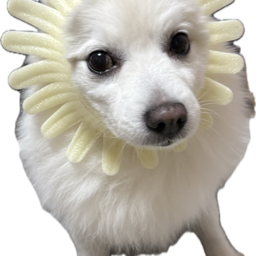
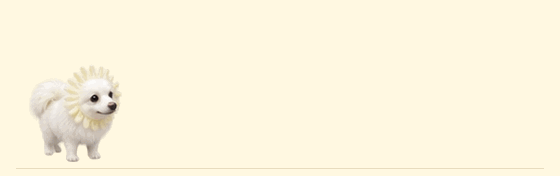

<p align="center"></p>

# Baby Flower Chanelu · 꽃개 샤네루

샤네루가 화면 아래(Dock 위)를 돌아다녀요. VS Code 창 위에도, 다른 앱 위에도 보여요.

Chanelu, a fluffy little flower puppy, walks along the bottom of your screen while you code.

<p align="center"></p>

> 화면 위를 걷는 기능은 **macOS 전용**이에요(Apple Silicon·Intel). 모니터가 여러 대면 옆 모니터로도 놀러 가요. 다른 OS에서는 탐색기 사이드바의 **샤네루** 패널 안에서만 돌아다녀요.
> The on-screen pet is **macOS only**. On other platforms Chanelu lives in the Explorer sidebar panel.

## VS Code 없이 쓰기 · Without VS Code

[**릴리스 페이지**](https://github.com/lalalalala00/baby-flower-chanelu/releases/latest)에서 내려받아 바로 실행하면 돼요. 설치는 필요 없어요.

| | 파일 | 처음 실행할 때 |
|---|---|---|
| 🍎 맥 | `Chanelu-mac.zip` → 압축을 풀고 `Chanelu.app`을 응용 프로그램 폴더로 | 경고가 뜨면 **시스템 설정 → 개인정보 보호 및 보안 → 그래도 열기** |
| 🪟 윈도우 10/11 | `Chanelu.exe` | "Windows의 PC 보호"가 뜨면 **추가 정보 → 실행** |

- 맥은 메뉴 막대, 윈도우는 작업 표시줄 트레이의 샤네루 아이콘에서 쓰다듬기·재우기·크기·종료를 할 수 있어요.
- 키보드·마우스를 한동안 안 쓰면 잠들고, 다시 쓰면 깨어나요.
- 윈도우는 트레이 메뉴에서 **윈도우 시작할 때 실행**을 켤 수 있어요. 맥은 **시스템 설정 → 일반 → 로그인 항목**에 Chanelu.app을 추가하세요.

Download `Chanelu-mac.zip` (macOS) or `Chanelu.exe` (Windows 10/11) from the [latest release](https://github.com/lalalalala00/baby-flower-chanelu/releases/latest). The apps are not code-signed, so the OS will warn on first launch.

## 이렇게 놀아요 · What Chanelu does

| | |
|---|---|
| 클릭 · Click | 하트 + 깡충 / 손 흔들기 / 두 발 서기 · hearts and a trick |
| 드래그 · Drag | 들어 올렸다 놓으면 툭 떨어져서 깡충 · pick up and drop |
| 저장 · Save | 깡충! · hops |
| 2분 동안 타이핑 없음 · Idle 2 min | 쿨쿨 잠들어요 · falls asleep |
| 타이핑 · Typing | 깨어나요 · wakes up |

## Claude · Codex와 같이 쓰기 · With AI coding agents

AI가 파일을 고치면 샤네루가 깨어나서 같이 돌아다녀요 (VS Code 확장이 파일 변경을 감지해요).
작업이 끝났을 때 깡충, 확인이 필요할 때 손 흔들기까지 하려면 아래를 설정하세요. (맥)

**Claude Code** — `~/.claude/settings.json`에 추가:

```json
"hooks": {
  "UserPromptSubmit": [{ "hooks": [{ "type": "command", "async": true, "command": "printf 'work\\n' | nc -U -w1 /tmp/chanelu-$(id -u).sock >/dev/null 2>&1 || true" }] }],
  "PostToolUse": [{ "matcher": "*", "hooks": [{ "type": "command", "async": true, "command": "printf 'work\\n' | nc -U -w1 /tmp/chanelu-$(id -u).sock >/dev/null 2>&1 || true" }] }],
  "Stop": [{ "hooks": [{ "type": "command", "async": true, "command": "printf 'done\\n' | nc -U -w1 /tmp/chanelu-$(id -u).sock >/dev/null 2>&1 || true" }] }],
  "Notification": [{ "hooks": [{ "type": "command", "async": true, "command": "printf 'attention\\n' | nc -U -w1 /tmp/chanelu-$(id -u).sock >/dev/null 2>&1 || true" }] }]
}
```

**Codex** — `~/.codex/config.toml` 맨 위에 추가:

```toml
notify = ["sh", "-c", "printf 'done\\n' | nc -U -w1 /tmp/chanelu-$(id -u).sock >/dev/null 2>&1 || true"]
```

## 명령 · Commands

- `샤네루 화면에 띄우기/숨기기` · `Show/Hide Chanelu on Screen`
- `샤네루 쓰다듬기` · `Pet Chanelu`
- `샤네루 재우기` · `Put Chanelu to Sleep`

## 설정 · Settings

| 키 · Key | 기본값 · Default | |
|---|---|---|
| `chanelu.showOnDesktop` | `true` | 화면 위에 띄우기 · show on screen |
| `chanelu.desktopSize` | `96` | 화면 위 키(px) · height on screen |
| `chanelu.size` | `72` | 사이드바 키(px) · height in sidebar |
| `chanelu.speed` | `40` | 걷는 속도 · walking speed |
| `chanelu.sleepAfterSeconds` | `120` | 잠들기까지(초), 0이면 안 잠 · 0 = never |

## 라이선스 · License

코드는 [MIT](LICENSE)라 자유롭게 가져다 고쳐 써도 돼요.

단, **샤네루 사진·그림과 캐릭터는 저작권자의 것**이에요. 이 확장 안에서 보이는 것 말고는 **개인적인 용도를 포함해 어떤 용도로도 쓸 수 없어요.** 저장·캡처해서 쓰기, 편집, 배경화면·프로필 사진·이모티콘·굿즈 제작, 공유, AI 학습 모두 금지예요. 코드를 가져다 쓸 땐 나만의 이미지로 바꿔 주세요.

The code is [MIT licensed](LICENSE). The Chanelu photos, artwork and character are © lalalalala00, all rights reserved: apart from being displayed by this extension, they may not be used in any way, **including private or personal use**, without written permission.
